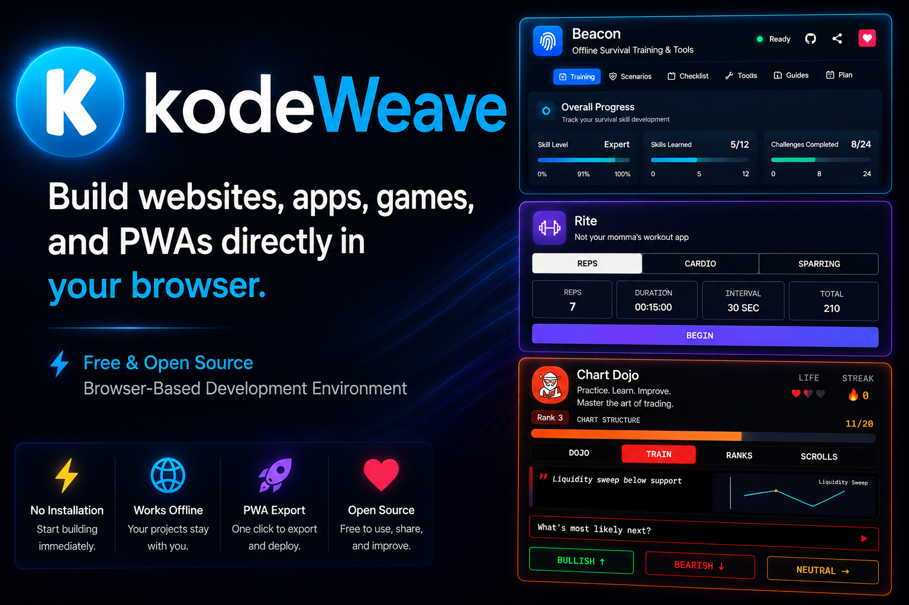
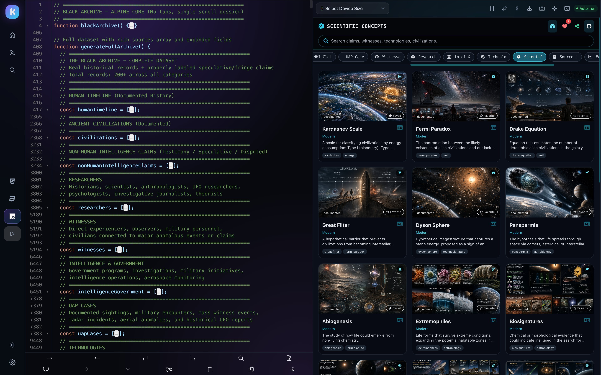
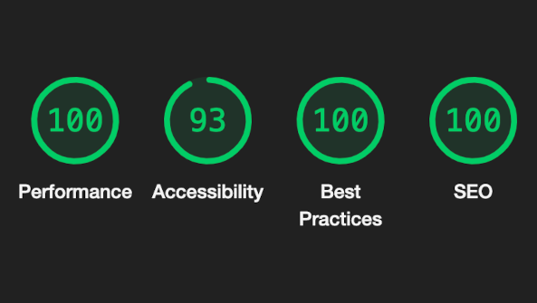

# 🧶 kodeWeave

**Build it. Preview it. Share it.**

**From an idea to a working website, app, or game — right in your browser.**

AI can help write code. kodeWeave gives you a place to make it yours: experiment, edit, run, refine, export, and share interactive projects. Free, open source, and ready on desktop or mobile — no account required.



[](https://michaelsboost.com/kodeWeave/go/)
[](https://github.com/michaelsboost/kodeWeave)
[](LICENSE)
[](https://github.com/michaelsboost/kodeWeave/stargazers)
[](https://github.com/michaelsboost/kodeWeave/issues)
[](https://x.com/kodeweave_app)

---

## 💡 What will you make?

**A landing page. A game. A timer. A dashboard. A full interactive app.**

kodeWeave gives you HTML, CSS, and JavaScript editors, a live preview, ready-to-explore framework templates, and ways to take your work beyond the editor. Create on desktop or mobile, then export your project or send someone a link to try it.



## 🎮 Built with kodeWeave

These projects show the range of things you can make — from practical tools to interactive experiences.

### 🧭 Beacon Survival

An offline-first survival training and preparedness application.

**[Launch Beacon Survival](https://michaelsboost.com/Beacon)**


### 🏋️ Rite Fitness Timer

A minimalist workout timer for interval training, stretching, martial arts, and everyday fitness.

**[Launch Rite Fitness Timer](https://michaelsboost.com/Rite)**


### 📈 Chart Dojo

An interactive chart-reading dojo for practicing trading pattern recognition and decision-making.

**[Launch Chart Dojo](https://michaelsboost.com/ChartDojo)**


**[Explore more projects on the kodeWeave homepage](https://michaelsboost.com/kodeWeave/)**

---

## ✨ Everything you need to start creating

- **Live coding workspace:** Edit HTML, CSS, and JavaScript and preview your work.
- **Framework starters:** Start from templates such as Alpine and React instead of an empty file.
- **Build anywhere:** Work in a mobile or desktop browser, with offline capabilities after the app's required resources are available.
- **Import and export:** Save portable kodeWeave JSON projects or work with a complete standalone HTML file containing HTML, CSS, and JavaScript; use the app's available export options, including PWA-related exports.
- **Share and preview:** Turn a publicly hosted project file into a full-screen preview link.
- **Open in the editor:** Send a project URL that loads into kodeWeave with the HTML editor visible.
- **Creative resources:** Explore built-in asset discovery and screenshot tools.
- **No account required:** Free and open-source, with no mandatory cloud workspace.

## 🔗 One project. Two ways to share it.

kodeWeave accepts publicly hosted **kodeWeave JSON projects** and **standalone HTML files**. You can put an entire application in one HTML file—including its CSS and JavaScript—and share or import it directly, without converting it to JSON. Both file formats support two experiences:

| Mode | What your friend sees |
| --- | --- |
| **Share** (`/share/?project=...`) | The project running full-screen, without the editor. |
| **Embed / Import** (`/embed/?project=...`) | kodeWeave opening the project in its editor, with HTML selected. |

### 🧪 Try a real project: Motiv8

Explore the same working app in **two file formats**. Each format can be previewed full-screen or opened in the kodeWeave editor.

| Project format | Full-screen preview | Open in editor | Source file |
| --- | --- | --- | --- |
| **kodeWeave JSON** — portable project data | [▶ View app](https://michaelsboost.com/kodeWeave/share/?project=https%3A%2F%2Fmichaelsboost.com%2Fmotiv8%2Fmotiv8-kodeWeave.json) | [✏️ Edit project](https://michaelsboost.com/kodeWeave/embed/?project=https%3A%2F%2Fmichaelsboost.com%2Fmotiv8%2Fmotiv8-kodeWeave.json) | [View JSON](https://michaelsboost.com/motiv8/motiv8-kodeWeave.json) |
| **Single HTML file** — HTML, CSS, and JavaScript in one file | [▶ View app](https://michaelsboost.com/kodeWeave/share/?project=https%3A%2F%2Fmichaelsboost.com%2Fmotiv8%2Fsingle-indexed.html) | [✏️ Edit project](https://michaelsboost.com/kodeWeave/embed/?project=https%3A%2F%2Fmichaelsboost.com%2Fmotiv8%2Fsingle-indexed.html) | [View HTML](https://michaelsboost.com/motiv8/single-indexed.html) |

**Share** opens the running app without the editor. **Embed / Import** loads the file into kodeWeave so you can explore and modify it.

### Make links for your own projects

1. Export a kodeWeave JSON project **or** prepare a standalone HTML file containing your app.
2. Host that file somewhere publicly accessible, such as a GitHub repository using its **raw file URL**.
3. In kodeWeave's **Export** dialog, find **Share & Embed**, paste the hosted URL, and copy the link you want.

For example, given a file at `https://example.com/my-project.json`, your links would look like:

```text
https://michaelsboost.com/kodeWeave/share/?project=https://example.com/my-project.json
https://michaelsboost.com/kodeWeave/embed/?project=https://example.com/my-project.json
```

The project URL can point to a `.json` or `.html` file. It is a reference to a hosted file: generating a link **does not upload the file**. Remote hosts must permit the browser to fetch the content (for example, through appropriate CORS headers). The project must remain accessible for shared links to work.

---

## ⚡ Built for the browser

kodeWeave uses JavaScript Proxies, a custom Virtual DOM, and DOM diffing to power its interface. Its goal is a responsive development environment without requiring every creator to set up a conventional desktop toolchain.



*Lighthouse image reflects a captured audit, not a guarantee of current scores on every device or deployment.*

## 📰 Featured on

- [Web Designer Depot](https://www.webdesignerdepot.com/5-essential-open-source-tools-for-web-designers/)
- [List Of Freeware](https://listoffreeware.com/free-open-source-dreamweaver-alternative-software-windows/)
- [Bootstrap Dash](https://www.bootstrapdash.com/blog/codepen-alternatives)
- [APTRON](https://aptronnoida.in/blog/essential-open-source-tools-for-web-designers/)
- [Linux for Devices](https://www.linuxfordevices.com/tutorials/linux/adobe-dreamweaver-alternatives)

---

## 🚀 Get started

Use the **Launch App** badge at the top to open the hosted editor. No installation is required.

To run the repository locally:

```bash
git clone https://github.com/michaelsboost/kodeWeave.git
cd kodeWeave
python3 -m http.server 8000
```

Then visit `http://localhost:8000/go/` to use the editor. Some development changes require rebuilding the JavaScript bundle; use the project's build tooling for those changes.

## 🛠️ Technology and tools

kodeWeave brings together open-source technologies and browser APIs, including:

- [CodeMirror](https://codemirror.net/) — code editing
- [Emmet](https://emmet.io/) — faster HTML and CSS authoring
- [Tailwind CSS](https://tailwindcss.com/) — interface styling
- [JSZip](https://stuk.github.io/jszip/) and [FileSaver.js](https://github.com/eligrey/FileSaver.js/) — client-side exports
- [html2canvas](https://html2canvas.hertzen.com/) — screenshots
- [cdnjs](https://cdnjs.com/api) — library discovery
- [Openverse](https://openverse.org/) and [Iconify](https://iconify.design/) — creative asset discovery
- Heroicons and Font Awesome — interface icons

## 🤝 Contribute

kodeWeave is free and open-source. Bug reports, pull requests, usability improvements, documentation fixes, and new ideas are welcome.

**[View source](https://github.com/michaelsboost/kodeWeave) · [Report an issue](https://github.com/michaelsboost/kodeWeave/issues) · [Star the repository](https://github.com/michaelsboost/kodeWeave/stargazers)**

## ❤️ Support the project

If kodeWeave helps you create something, share your work, star the repository, or contribute code and feedback. You can also [support continued development](https://michaelsboost.com/donate).

## 📄 License

kodeWeave is free, open-source software licensed under the [MIT License](LICENSE).

## 👋 Creator

Created by Michael Schwartz · [michaelsboost.com](https://michaelsboost.com) · [@kodeweave_app](https://x.com/kodeweave_app)

**Build something. Share it. Inspire someone else to build.**
